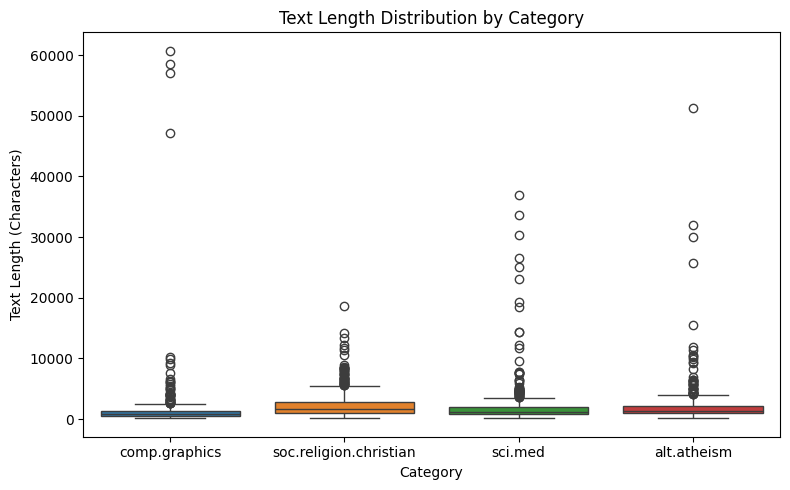
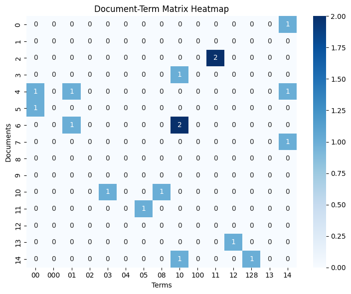
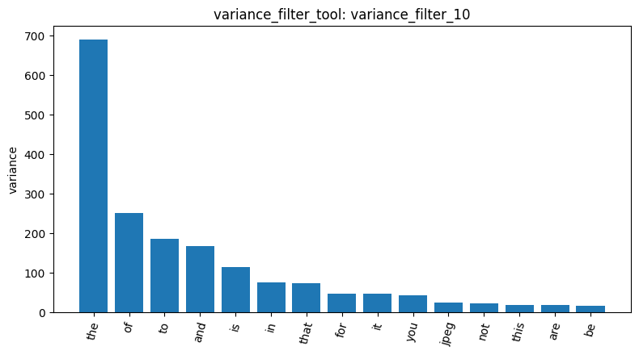
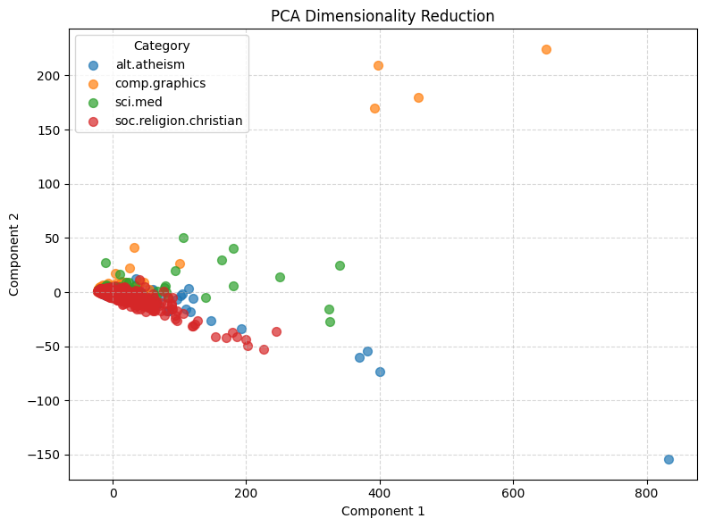

# Agentic Pipeline Report

## 1. Introduction

This report analyzes a subset of the 20 Newsgroups dataset using a text mining pipeline. Four categories were selected: `alt.atheism`, `comp.graphics`, `sci.med`, and `soc.religion.christian`. The analysis covers dataset inspection, data quality checks, document length statistics, document-term matrix construction, term frequency analysis, variance filtering, feature correlation, frequent pattern mining, dimensionality reduction, label encoding, and document similarity.

The main objective is to examine how text features vary across these four topics and evaluate whether the resulting representations reveal meaningful differences between categories. Particular attention is paid to the influence of document length, common English words, and email-style headers on the analysis.

## 2. Dataset Inspection and Data Quality

The dataset was loaded using `load_dataset_1`, which returned 2,257 documents across the four selected categories.

| Category | Number of documents |
|---|---:|
| `alt.atheism` | 480 |
| `comp.graphics` | 584 |
| `sci.med` | 594 |
| `soc.religion.christian` | 599 |
| **Total** | **2,257** |

The largest category was `soc.religion.christian`, with 599 documents, while `alt.atheism` was the smallest, with 480. Although the category sizes were not identical, all four categories had several hundred documents available for analysis.

Dataset inspection (`inspect_data_2`) confirmed that the data contained three columns: `text`, `category`, and `category_name`. The `category` column stores integer identifiers, while `category_name` contains the corresponding readable category names.

The missing-value check (`check_missing_3`) found zero missing or empty text entries, corresponding to 0% of the dataset. The duplicate check (`check_duplicates_4`) also found zero duplicate documents. Therefore, no rows needed to be removed based on these two checks.

However, the inspected examples contained email-style headers, including sender information and subject lines. These fields are part of the text being analyzed and may influence later results even when the underlying document content is topically different.

## 3. Document Length Analysis

Document length statistics were calculated using `describe_data_5`. Across all 2,257 documents, the mean text length was 1,992.96 characters, the median was 1,235 characters, and the standard deviation was 3,547.66 characters. The longest document contained 60,713 characters.

The category-level statistics were as follows:

| Category | Mean length (characters) | Median length (characters) | Maximum length (characters) |
|---|---:|---:|---:|
| `alt.atheism` | 2,167.30 | 1,382.5 | 51,239 |
| `comp.graphics` | 1,557.08 | 883 | 60,713 |
| `sci.med` | 2,008.12 | 1,238.5 | 37,009 |
| `soc.religion.christian` | 2,263.18 | 1,649 | 18,660 |

The `soc.religion.christian` category had the highest mean and median document lengths. In contrast, `comp.graphics` had the lowest mean and median, but it contained the single longest document in the dataset.

*Figure 1. Document length distributions across the four categories, generated by `describe_data_5`.*

These differences matter because raw term counts are influenced by document length. A longer document has more opportunities to contain a given word, which may increase its contribution to the overall counts. Therefore, differences in term frequency across categories should not automatically be interpreted as differences in topic relevance. Normalization, stop-word removal, or more targeted text preprocessing could help address this limitation.

## 4. Document-Term Matrix

A document-term matrix was constructed using `build_dtm_6`, with `max_features=2000` and `min_df=5`. This configuration retained at most 2,000 terms and excluded terms appearing in fewer than five documents.

The resulting matrix had the following properties:

| Metric | Value |
|---|---:|
| Documents | 2,257 |
| Terms | 2,000 |
| Non-zero entries | 251,423 |
| Total matrix elements | 4,514,000 |
| Sparsity | 94.4302% |

The matrix was highly sparse: approximately 94.43% of its entries were zero. In other words, only 5.5698% of the document-term combinations had non-zero counts.

This is expected in text mining because each document contains only a small subset of the vocabulary represented across the entire dataset. The four categories also discuss different subjects, so many terms appear in only a portion of the documents.

The `max_features` and `min_df` settings reduced the vocabulary size, but they did not remove all uninformative words or artifacts. The subsequent analysis demonstrates why feature selection should consider not only frequency but also the meaning and context of the retained terms.

## 5. Term Frequency Analysis

The 15 most frequent terms were obtained using `term_frequency_7`.

| Term | Frequency |
|---|---:|
| `the` | 29,825 |
| `of` | 17,660 |
| `to` | 17,222 |
| `and` | 13,017 |
| `is` | 12,343 |
| `in` | 11,226 |
| `that` | 10,723 |
| `it` | 8,447 |
| `you` | 6,157 |
| `for` | 5,962 |
| `not` | 5,285 |
| `this` | 5,063 |
| `be` | 4,898 |
| `from` | 4,877 |
| `are` | 4,769 |

The most frequent terms were primarily common English function words rather than topic-specific vocabulary. These words appear across many kinds of documents, so their high frequencies do not indicate that they are useful for distinguishing the four categories.

This finding suggests that frequency-based analysis alone is insufficient for identifying the most informative features. Removing common stop words, applying TF-IDF weighting, or selecting features based on their association with category labels could make the representation more focused on topic-related content.

## 6. Document-Term Matrix Heatmap

A heatmap of the first 15 documents and the first 15 terms was generated using `dtm_heatmap_8`. The displayed terms were:

`00`, `000`, `01`, `02`, `03`, `04`, `05`, `08`, `10`, `100`, `11`, `12`, `128`, `13`, and `14`.

Most cells in the selected matrix slice were zero, with only a few non-zero word counts.

*Figure 2. Heatmap of the first 15 documents and first 15 terms, generated by `dtm_heatmap_8`.*

The numeric terms appear first because the vocabulary is ordered alphabetically, and digit strings precede alphabetic words in this ordering. Consequently, this particular slice is dominated by numeric tokens rather than meaningful topic vocabulary.

The heatmap illustrates the sparsity of the matrix, but it does not provide a representative view of the most informative terms. This is an important limitation when interpreting a small slice of a large document-term matrix: the selected rows and columns may not capture the most meaningful patterns in the corpus.

## 7. Variance Filtering

Variance filtering was performed using two thresholds.

The first run, `variance_filter_9`, used a threshold of 0.01. All 2,000 terms were retained, and no terms were removed.

The second run, `variance_filter_10`, used a threshold of 0.05. This time, 1,450 terms were retained and 550 were removed.

| Result ID | Threshold | Terms retained | Terms removed |
|---|---:|---:|---:|
| `variance_filter_9` | 0.01 | 2,000 | 0 |
| `variance_filter_10` | 0.05 | 1,450 | 550 |

The results show that the effect of variance filtering depends on the chosen threshold. A threshold of 0.01 did not reduce the vocabulary, whereas a threshold of 0.05 removed 27.5% of the original 2,000 terms.

*Figure 3. Visualization of the variance-filtering result for `variance_filter_10`.*

Variance filtering can reduce the feature space by removing terms with low variability. However, a term with low variance is not necessarily irrelevant, and a term with high variance is not necessarily informative about a category. This step is therefore best interpreted as a feature-reduction technique rather than a direct measure of topic importance.

## 8. Correlation Analysis

Pearson and Spearman correlation analyses were performed for the target category `sci.med`, using `pearson_filter_11` and `spearman_filter_12`.

### 8.1. Pearson correlation

The highest-ranked terms reported by `pearson_filter_11` included:

| Term | Pearson correlation |
|---|---:|
| `pitt` | 0.3795 |
| `gordon` | 0.3552 |
| `geb` | 0.3447 |
| `banks` | 0.3444 |
| `n3jxp` | 0.3208 |
| `chastity` | 0.3174 |
| `intellect` | 0.3174 |
| `cadre` | 0.3166 |
| `dsl` | 0.3166 |
| `shameful` | 0.3166 |

The strongest association was observed for `pitt`, with a Pearson correlation of 0.3795. Several other terms also showed positive associations with the `sci.med` label.

However, some of these terms appear to be names, identifiers, or other artifacts rather than clear medical concepts. Their correlation with the category may reflect the particular documents in which they occur, rather than a general semantic relationship with medicine.

### 8.2. Spearman correlation

The top terms reported by `spearman_filter_12` included:

| Term | Spearman correlation |
|---|---:|
| `pitt` | 0.3950 |
| `gordon` | 0.3796 |
| `geb` | 0.3677 |
| `banks` | 0.3633 |
| `n3jxp` | 0.3208 |
| `disease` | 0.3201 |
| `god` | -0.3191 |
| `medical` | 0.3186 |
| `chastity` | 0.3174 |
| `intellect` | 0.3174 |

The Spearman results were broadly similar to the Pearson results, with several of the same terms appearing near the top. Unlike the Pearson top-ten list, the Spearman results included the domain-related terms `disease` and `medical`, both positively associated with `sci.med`. The term `god` had a negative correlation of -0.3191, which is consistent with its association with religious discussion rather than medical discussion in this particular dataset.

The two correlation methods measure different types of association: Pearson evaluates linear relationships, while Spearman evaluates monotonic relationships using ranks. Their similar rankings suggest that several terms have consistent associations with the target label, although correlation alone does not establish causation or guarantee classification performance.

Overall, the correlation results provide evidence that some vocabulary is associated with the `sci.med` category. However, the presence of names and identifiers among the strongest terms also reveals the importance of cleaning and contextualizing the text before drawing semantic conclusions.

## 9. Frequent Pattern Mining

Frequent pattern mining was used to identify recurring terms and combinations of terms within categories.

The initial attempts encountered a `UnicodeDecodeError` while processing the text. After the tool was rerun, the mining operation completed successfully for `sci.med` and `comp.graphics`, producing `patterns_2` and `patterns_3`, respectively.

### 9.1. Frequent patterns in `sci.med`

The successful FP-Growth run for `sci.med` used TF-IDF filtering and a minimum support of 80. It produced 6,447 patterns (`patterns_2`).

The top patterns included:

| Pattern | Support |
|---|---:|
| `subject` | 594 |
| `lines` | 585 |
| `subject`, `lines` | 585 |
| `organization` | 582 |
| `organization`, `subject` | 582 |
| `organization`, `lines` | 573 |
| `subject`, `organization`, `lines` | 573 |
| `edu` | 416 |
| `edu`, `subject` | 416 |
| `edu`, `lines` | 410 |

These patterns are dominated by terms associated with Usenet post headers, such as `subject`, `lines`, `organization`, and `edu`, rather than clearly medical terms.

This is a significant finding because it indicates that frequent pattern mining is capturing repeated document structure. For example, the word `subject` can appear in the header of a newsgroup post regardless of whether the post discusses medicine, graphics, or religion.

### 9.2. Frequent patterns in `comp.graphics`

The `comp.graphics` run used TF-IDF filtering with the Top-K algorithm and `k=10`. The result, `patterns_3`, returned the following leading patterns:

| Pattern | Support |
|---|---:|
| `lines` | 584 |
| `subject` | 584 |
| `lines`, `subject` | 584 |
| `organization` | 560 |
| `subject`, `lines`, `organization` | 560 |
| `lines`, `organization` | 560 |
| `subject`, `organization` | 560 |
| `edu` | 320 |
| `subject`, `lines`, `edu` | 320 |
| `lines`, `edu` | 320 |

The same header-related terms appeared in this category. Comparing `patterns_2` and `patterns_3` shows substantial overlap in the most frequent patterns, even though `sci.med` and `comp.graphics` discuss different topics.

This overlap suggests that the pattern-mining results are strongly influenced by shared newsgroup formatting. Consequently, the results do not provide strong evidence that the two categories have similar semantic content. Instead, they highlight the limitations of mining patterns from raw text that includes headers and other structural information.

A useful improvement would be to remove email headers and other non-content fields before running the analysis again. This was not performed in the current pipeline, so the potential benefit remains a recommendation rather than a demonstrated result.

## 10. Dimensionality Reduction with PCA

Principal Component Analysis was used to project the document-term matrix into two dimensions. The result was recorded as `reduction_14`.

The first principal component explained 69.6254% of the variance, while the second explained 4.4228%. Together, the two components explained 74.0482% of the total variance in the 2,000-term representation.

*Figure 4. Two-dimensional PCA projection of the 20 Newsgroups documents, generated by `reduction_14`.*

The plot showed substantial overlap among the four categories. The documents also stretched along the first principal component, rather than forming four clearly separated clusters.

One possible explanation is that the raw term-count representation captures document length and shared vocabulary as major sources of variation. Since the first component accounts for nearly 70% of the variance, differences in overall word counts may strongly influence the projection.

However, PCA is an unsupervised dimensionality-reduction method, and the two-dimensional plot preserves only part of the information in the original representation. The overlapping clusters therefore do not prove that the categories cannot be distinguished. They show only that the first two principal components do not provide a clear visual separation with the current features.

## 11. Label Encoding

The category labels were converted into a binary indicator matrix using `binarize_labels_15`.

The resulting matrix had a shape of `[2257, 4]`, representing 2,257 documents and four binary label columns. The label order was:

1. `alt.atheism`
2. `comp.graphics`
3. `sci.med`
4. `soc.religion.christian`

The document counts in the binary representation matched the original category distribution: 480 for `alt.atheism`, 584 for `comp.graphics`, 594 for `sci.med`, and 599 for `soc.religion.christian`.

This transformation represents each document's category using a four-element indicator vector. It is useful for downstream tasks that require categorical labels in a numerical format, including some classification and multi-output processing workflows.

## 12. Cosine Similarity

Cosine similarity was calculated for two document pairs using `cosine_similarity_16` and `cosine_similarity_17`.

| Result ID | Document pair | Reported categories | Cosine similarity |
|---|---|---|---:|
| `cosine_similarity_16` | Document 1 and Document 2 | `comp.graphics` and `soc.religion.christian` | 0.5117 |
| `cosine_similarity_17` | Document 1 and Document 3 | `comp.graphics` and `soc.religion.christian` | 0.4618 |

Both pairs involved documents from different categories, despite the initial intention to compare documents from the same category and different categories. The similarity scores were 0.5117 and 0.4618, respectively.

These results demonstrate that documents from different categories can still have moderately high cosine similarity in the current representation. Shared words, common English function words, and recurring newsgroup headers may contribute to this similarity.

The comparison also has a limitation: because both pairs are cross-category pairs, it does not provide a direct same-category versus cross-category comparison. Therefore, the two values cannot establish whether documents within the same category are generally more similar than documents across categories.

A more systematic comparison would require examining multiple document pairs from both the same and different categories, preferably after removing common stop words and applying a representation such as TF-IDF. Such an experiment would provide stronger evidence about how well cosine similarity captures topical similarity.

## 13. Discussion

Several important observations emerge from the pipeline.

First, the four categories have different document length distributions. The `soc.religion.christian` category has the highest mean and median text lengths, while `comp.graphics` contains the longest individual document. These differences can influence raw word counts and should be considered when comparing categories.

Second, the document-term matrix is highly sparse, with 94.4302% of its entries equal to zero. This is expected for text data, but it also means that many terms are absent from most documents. The top-frequency terms are dominated by common English function words, suggesting that preprocessing and feature selection are important for producing more informative representations.

Third, variance filtering removed 550 terms at a threshold of 0.05, while the lower threshold of 0.01 removed none. This demonstrates that feature reduction depends strongly on the chosen threshold. Correlation analysis identified terms associated with `sci.med`, including `disease` and `medical`, but also names and identifiers that may reflect dataset-specific artifacts.

Fourth, frequent pattern mining exposed a particularly important limitation. The top patterns for both `sci.med` and `comp.graphics` were dominated by header-related terms such as `subject`, `lines`, and `organization`. This means that recurring document structure can obscure the topic-specific patterns that the analysis is intended to discover.

Finally, the PCA projection showed substantial overlap among categories, while the cosine similarity results showed moderate similarity between selected documents from different categories. Both findings are consistent with the influence of shared vocabulary and document formatting. However, neither analysis alone provides a definitive measure of classification performance or overall category separability.

The main limitation of the current pipeline is that the text was analyzed without removing email headers, footers, or quoted replies. The current tools did not expose a direct option for stripping these fields during dataset loading. As a result, some of the strongest features and patterns may describe how newsgroup messages are formatted rather than what the messages are about.

## 14. Conclusion

This report examined 2,257 documents from four categories of the 20 Newsgroups dataset using a sequence of text mining tools. The dataset contained no missing or duplicate documents according to the checks performed. Document length analysis revealed substantial variation across categories, and the document-term matrix contained 2,000 terms with 94.4302% sparsity.

Term frequency analysis showed that common English words dominated the vocabulary. Variance filtering reduced the number of features at a threshold of 0.05, while correlation analysis identified terms associated with `sci.med`. Frequent pattern mining, however, was strongly affected by generic newsgroup headers, producing similar top patterns for `sci.med` and `comp.graphics`. PCA also showed substantial overlap between the four categories, and the selected cosine similarity comparisons revealed moderate similarity between documents from different categories.

Overall, the results demonstrate that the quality of text preprocessing has a major influence on downstream analysis. In particular, removing headers and other non-content text, reducing the influence of common words, and using more informative text representations would likely make the analysis more focused on topic-specific vocabulary. These are proposed improvements; they would need to be tested in a subsequent run before their effects could be confirmed.