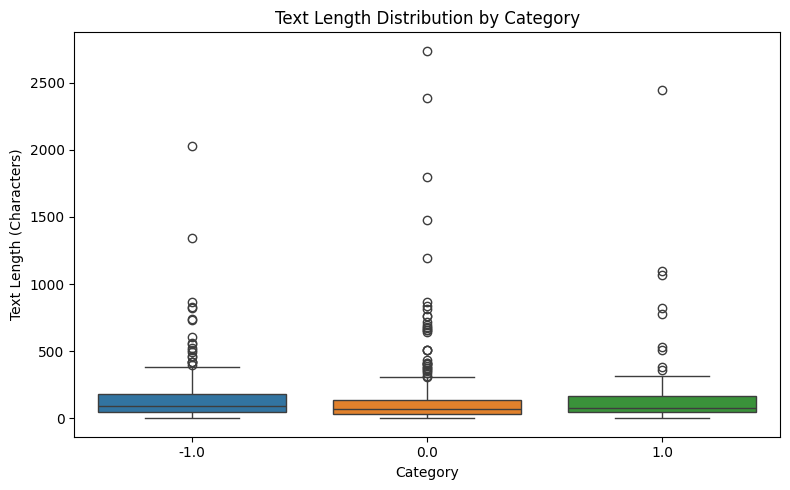
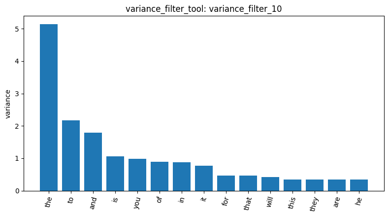
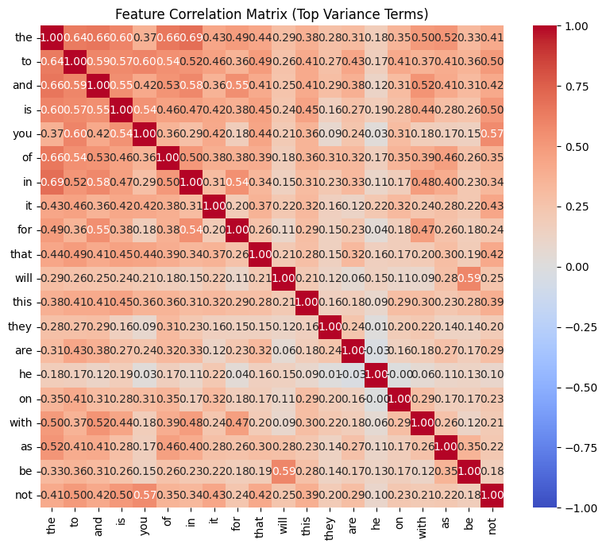
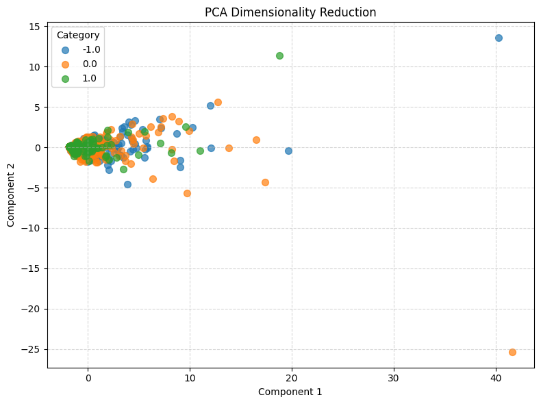
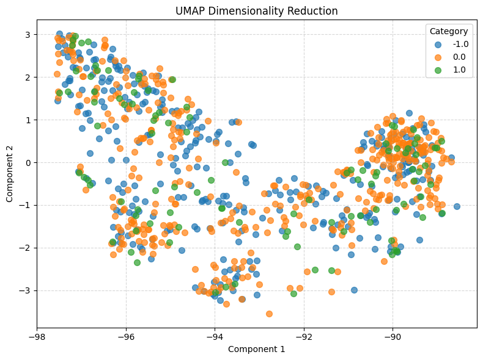

# Homework report

## 1. Introduction

This report explores the text characteristics and sentiment-related patterns of a Reddit stock sentiment dataset using a text mining pipeline. The analysis covers data inspection and cleaning, document-term matrix construction, term frequency analysis, feature filtering and correlation, frequent pattern mining, dimensionality reduction, label encoding, and document similarity.

The objective is to understand the structure of the dataset, identify terms associated with different sentiment categories, and investigate whether the three sentiment classes can be clearly distinguished using the analyzed text features.

## 2. Dataset Inspection and Cleaning

The dataset `newdataset/Reddit-stock-sentiment.csv` was loaded using `load_dataset_1`. It originally contained 847 rows. The text column was checked for missing or empty values, and duplicate documents were examined before cleaning.

The duplicate check (`check_duplicates_5`) identified 23 duplicate groups involving 34 rows. After removing duplicate rows with `check_duplicates_6`, the dataset contained 813 documents. Removing duplicates helps prevent repeated posts from disproportionately influencing term frequencies and pattern mining.

The cleaned dataset contained three sentiment categories:

| Sentiment label | Number of documents |
|---|---:|
| Negative (-1.0) | 315 |
| Neutral (0.0) | 391 |
| Positive (1.0) | 107 |
| **Total** | **813** |

The neutral category was the largest, while the positive category was the smallest. This class imbalance is important when interpreting later results because patterns and visualizations may be influenced by the number of available documents in each category.

## 3. Text Length Analysis

The descriptive statistics from `describe_data_7` showed that the 813 posts had an average length of 147.19 characters and a median length of 78 characters. The standard deviation was 239.01 characters, indicating substantial variation in post length. The longest post contained 2,737 characters.

The category-level mean lengths were:

| Sentiment label | Mean length (characters) | Median length (characters) |
|---|---:|---:|
| Negative (-1.0) | 152.82 | 96 |
| Neutral (0.0) | 137.87 | 68 |
| Positive (1.0) | 164.64 | 77 |

Positive posts had the highest mean length, whereas neutral posts had the lowest mean and median lengths. However, the maximum length was observed in the neutral category. These differences suggest that post length varies across documents, but length alone does not establish sentiment.

*Figure 1. Text length statistics generated by `describe_data_7`.*

## 4. Document-Term Matrix and Term Frequency

A document-term matrix (DTM) was constructed using `build_dtm_8`, with `min_df=3`. This retained terms appearing in at least three documents.

The resulting matrix contained 813 documents and 1,047 terms, with 12,781 non-zero entries out of 851,211 possible entries. Its sparsity was approximately 98.50%.

The high sparsity is expected for short social media posts: each post contains only a small subset of the vocabulary represented in the full matrix. Consequently, most document-term combinations have a value of zero.

The term frequency analysis (`term_frequency_9`) found that the most frequent terms were common English function words, including *the*, *to*, *and*, *is*, *it*, *of*, *in*, and *that*. These words are frequent across many types of text and are not necessarily informative about stock sentiment.

This result illustrates a limitation of raw term frequency: frequently occurring words do not automatically provide useful evidence for distinguishing positive, neutral, and negative sentiment. Additional preprocessing or feature selection may be needed to emphasize more informative vocabulary.

## 5. Feature Filtering and Correlation Analysis

### 5.1. Variance filtering

Variance filtering was performed using a threshold of 0.01 (`variance_filter_10`). Of the 1,047 terms evaluated, 413 were retained and 634 were removed.

This step reduced the vocabulary by removing terms that did not meet the selected variance threshold. Although reducing the number of features can simplify subsequent analysis, variance alone does not determine whether a term is useful for sentiment classification.

*Figure 2. Terms displayed in the variance-filter visualization for `variance_filter_10`.*

### 5.2. Correlation with positive sentiment

Pearson and Spearman correlation analyses were conducted for the positive sentiment class (1.0), using `pearson_filter_11` and `spearman_filter_12`.

The highest Pearson correlation reported was 0.1563, associated with the terms *huge*, *main*, and *tldr*. The highest Spearman correlation was 0.1609, associated with *technology*. These values indicate that the strongest individual term associations reported by these analyses were relatively weak.

The two methods ranked terms somewhat differently because Pearson correlation measures linear association, whereas Spearman correlation evaluates monotonic association based on ranks. A term can therefore rank differently depending on the type of relationship captured by each method.

The correlation heatmap (`feature_correlation_13`) also showed that *the* and *in* had the strongest reported pairwise Pearson correlation, at 0.6922. Because both are common grammatical words, their association is more plausibly related to shared language usage than to a meaningful stock sentiment relationship.

*Figure 3. Feature correlation visualization for `feature_correlation_13`.*

Overall, the correlation results suggest that frequent or strongly correlated terms are not necessarily sentiment-specific. The findings should therefore be interpreted as exploratory associations rather than evidence that individual words determine sentiment.

## 6. Frequent Pattern Mining

FP-Growth was used to examine frequent terms within individual sentiment categories. The analyses used TF-IDF filtering and different minimum support thresholds.

### 6.1. Negative sentiment

For category -1.0, FP-Growth with a minimum support of 20 found eight patterns (`patterns_14`). The highest-support patterns included:

| Term | Support |
|---|---:|
| *trump* | 42 |
| *just* | 42 |
| *china* | 33 |
| *like* | 25 |
| *think* | 23 |
| *people* | 23 |
| *market* | 23 |
| *going* | 21 |

These results show that the negative category contains both topic-related terms, such as *trump*, *china*, and *market*, and general conversational words, such as *just*, *like*, and *think*. The topic-related terms may reflect the subjects discussed in the posts, but their presence alone does not prove that the posts express negative sentiment because of those topics.

### 6.2. Positive sentiment and support thresholds

For category 1.0, the initial FP-Growth run with minimum support 20 found no patterns (`patterns_15`). When the minimum support was lowered to 10, two patterns were found (`patterns_16`): *just* with support 15 and *good* with support 12.

With the threshold reduced further to 5, the tool found 16 patterns (`patterns_17`). The leading patterns included *just* (15), *good* (12), *doing* (9), *like* (8), *going* (8), *think* (7), *time* (6), *economy* (6), *way* (6), and *new* (5).

Lowering the support threshold allowed less frequent terms to appear in the results. The contrast between the negative and positive categories demonstrates that the number of discovered patterns depends on the threshold as well as the distribution of terms within each category. It does not, by itself, establish that one sentiment class is more coherent than another.

The two categories also share conversational words such as *just*, *like*, *think*, and *going*. This overlap suggests that common vocabulary alone may not be sufficient to distinguish sentiment reliably.

## 7. Dimensionality Reduction

### 7.1. Principal Component Analysis (PCA)

PCA was used to project the 813 documents into two dimensions (`reduction_18`). The first principal component explained 31.45% of the variance, while the second explained 5.48%. Together, the two components explained approximately 36.93% of the variance.

The two-dimensional projection did not show clear separation among the negative, neutral, and positive categories.

*Figure 4. PCA projection of the documents, colored by sentiment category (`reduction_18`).*

This overlap suggests that the first two principal components do not capture a clear separation between the sentiment labels. However, PCA is an unsupervised dimensionality-reduction method, and a two-dimensional projection preserves only part of the variation in the original feature space. Therefore, the observed overlap does not prove that sentiment cannot be predicted from the text.

### 7.2. Uniform Manifold Approximation and Projection (UMAP)

UMAP was also applied with `n_neighbors=15` and `random_state=42` (`reduction_19`). Similar to PCA, the resulting visualization did not show clearly separated regions for the three sentiment categories.

*Figure 5. UMAP projection of the documents, colored by sentiment category (`reduction_19`).*

The UMAP result suggests that the local structure represented by this projection does not clearly separate the sentiment classes either. Considered together, the PCA and UMAP visualizations indicate that the analyzed document representation does not produce obvious sentiment clusters in two dimensions. Other representations or supervised methods would need to be evaluated separately before drawing conclusions about predictive performance.

## 8. Label Encoding and Document Similarity

The category labels were converted into a binary indicator matrix using `binarize_labels_20`. The label order was `['-1.0', '0.0', '1.0']`, and the resulting matrix had shape `[813, 3]`. The class counts remained 315 negative, 391 neutral, and 107 positive documents.

Cosine similarity was then calculated for three pairs of documents:

| Result ID | Document categories | Cosine similarity |
|---|---|---:|
| `cosine_similarity_21` | -1.0 and 0.0 | 0.0000 |
| `cosine_similarity_22` | -1.0 and 0.0 | 0.0000 |
| `cosine_similarity_23` | 0.0 and 0.0 | 0.2037 |

The first two pairs belonged to different sentiment categories and had reported similarities of zero. The third pair contained two neutral documents and had a similarity of 0.2037.

These examples illustrate that documents with different labels can have very low similarity, while documents with the same label can share some textual features. However, only three pairs were examined, so these observations are not sufficient to establish a general relationship between cosine similarity and sentiment labels.

## 9. Discussion

Several findings emerge from the analysis.

First, the dataset contains short and sparse documents. The DTM has 98.50% sparsity, and the most frequent terms are predominantly common English function words. This means that raw frequency counts may emphasize general language structure rather than sentiment-specific information.

Second, feature filtering and correlation analysis reduce or characterize the vocabulary, but the strongest reported individual correlations with positive sentiment are weak. The strongest pairwise correlation in the heatmap is between *the* and *in*, which illustrates that statistical association between terms does not necessarily imply sentiment relevance.

Third, FP-Growth reveals different pattern counts depending on the sentiment category and support threshold. The negative category produced eight patterns at a support threshold of 20, while the positive category produced none at that threshold. Lowering the positive-category threshold to 5 yielded 16 patterns. Some frequent terms were shared between categories, suggesting that common conversational vocabulary may have limited discriminative value.

Finally, both PCA and UMAP produced two-dimensional projections without clear separation of the sentiment classes. This is consistent with the observation that common vocabulary appears across categories. Nevertheless, dimensionality-reduction plots are exploratory visualizations, not direct evaluations of a sentiment classifier.

These findings should be interpreted with several limitations in mind. The positive category contains fewer documents than the neutral and negative categories. The analysis also relies on a sparse document-term representation, and the inspected cosine similarities cover only three document pairs. No classification experiment was reported here, so the results do not measure accuracy, precision, recall, or other predictive performance metrics.

## 10. Conclusion

This analysis examined 813 Reddit stock sentiment posts through data cleaning, text-length statistics, document-term matrix construction, term frequency analysis, feature filtering, correlation analysis, frequent pattern mining, dimensionality reduction, label encoding, and cosine similarity.

The dataset was highly sparse, and common grammatical words dominated the most frequent terms. Correlation analysis found only weak individual associations with positive sentiment, while FP-Growth results varied substantially with the minimum support threshold. PCA and UMAP did not reveal clear two-dimensional clusters corresponding to the three sentiment categories.

Taken together, the results suggest that the analyzed vocabulary and exploratory visualizations do not provide an obvious separation of sentiment classes. They also highlight the importance of careful feature selection and cautious interpretation of text-mining results. Further experiments would be required to determine whether alternative text representations or supervised learning methods could distinguish the sentiment categories effectively.